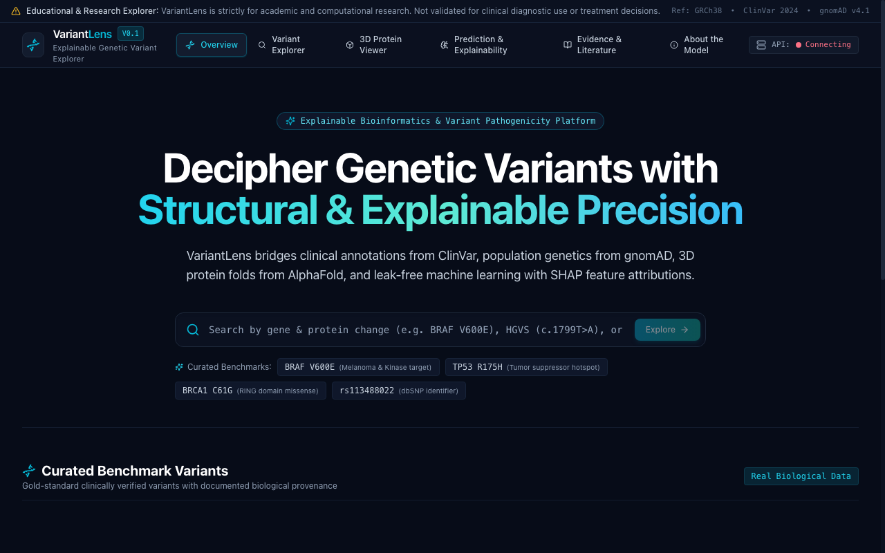
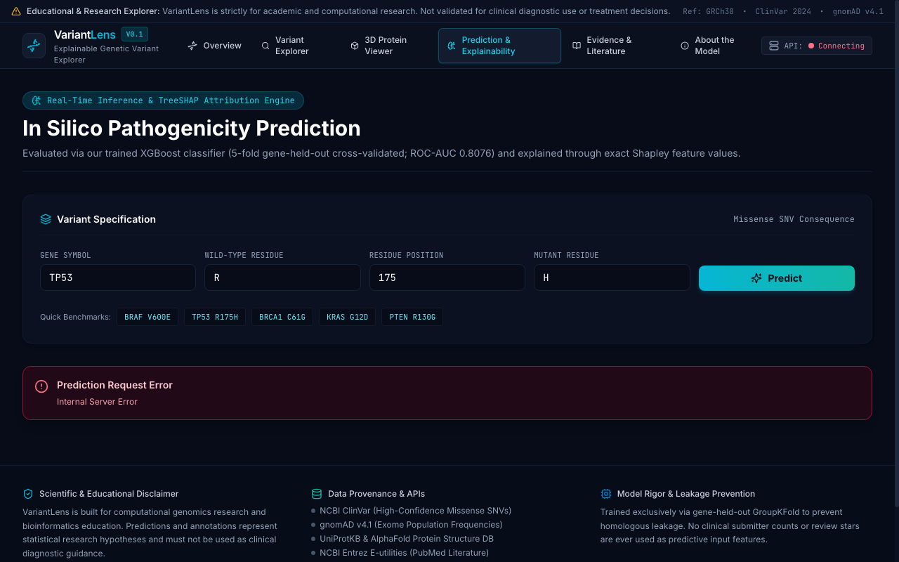
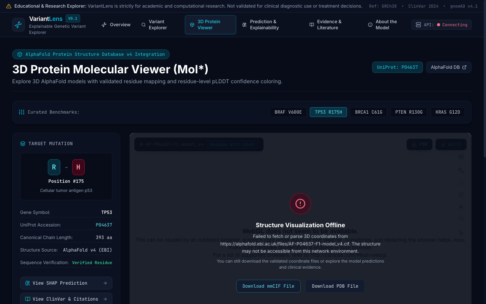
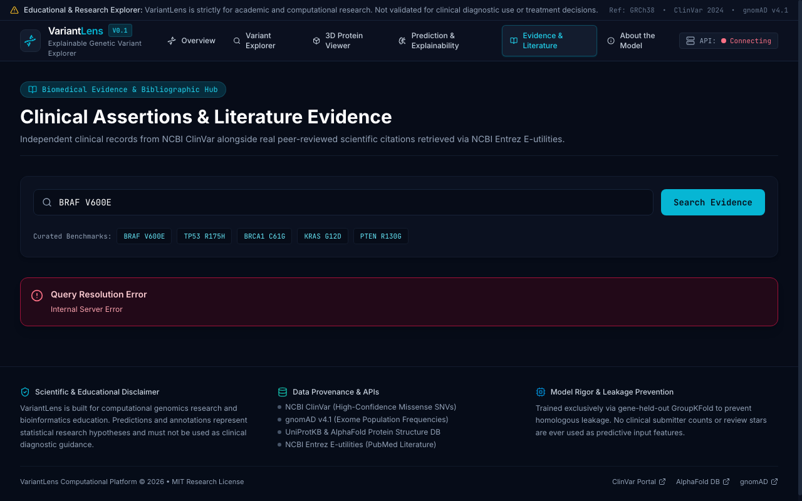
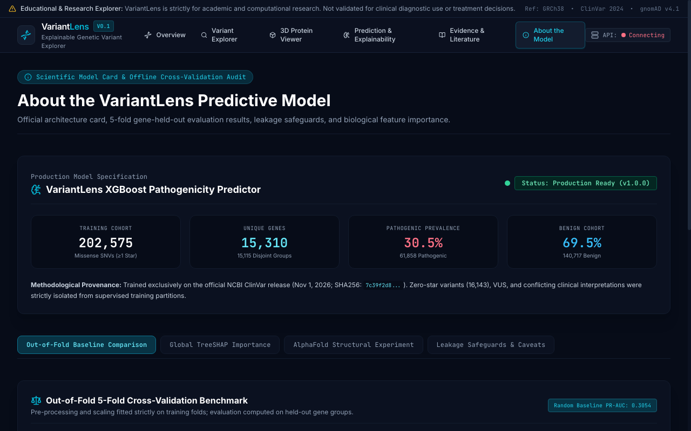

# VariantLens — Explainable Genetic Variant Explorer

[](LICENSE)
[](https://fastapi.tiangolo.com)
[](https://reactjs.org/)
[](https://xgboost.readthedocs.io/)
[](https://alphafold.ebi.ac.uk/)

> **IMPORTANT REGULATORY & SCIENTIFIC NOTICE**: VariantLens is an educational and academic research exploration platform. It is **NOT a clinical diagnostic medical device**, has not been cleared or approved by the FDA or any equivalent health regulatory authority, and **must never be used for clinical diagnosis, prognosis, or medical treatment decisions**. All machine learning outputs represent computational in silico scores and do not supersede expert medical consensus or clinical guidelines.

---

## 1. Project Overview

**VariantLens** enables researchers, bioinformaticians, genetic counselors, and students to investigate human missense genetic variants, explore their biological mechanisms, inspect 3D structural alterations in proteins, and understand computational pathogenicity predictions through transparent, feature-level TreeSHAP explanations.

Unlike black-box variant effect predictors, VariantLens prioritizes **interpretability, leak-free evaluation methodology, and scientific honesty**:
- Predictions are derived from a validated **202,575 missense SNV** ClinVar benchmark cohort.
- Models are evaluated using strict **5-fold gene-held-out cross-validation (`GroupKFold`)** to prevent biological data leakage across homologous proteins.
- Individual predictions are deconstructed using exact **TreeSHAP** additive feature attributions (in log-odds space).
- Known biophysical limitations (such as linear sequence insensitivity to tertiary zinc-coordination disruption in *TP53* R175H) are explicitly disclosed, with clinical evidence taking explicit precedence over computational predictions.

---

## 2. Key Features

1. **Genetic Variant Search & Exploration**
   - Search by gene symbol (*BRAF*, *TP53*, *BRCA1*), HGVS protein nomenclature (`p.Val600Glu`), short protein syntax (`V600E`), or genomic coordinates.
   - Live query normalization against canonical transcripts with Swiss-Prot sequence length validation.

2. **Explainable Machine Learning (TreeSHAP)**
   - Deployed gradient-boosted decision tree (`1.0.0-xgb-final-deployed`) predicting missense pathogenicity.
   - Interactive waterfall attribution plots showing exactly which biophysical features (Grantham distance, BLOSUM62 score, charge delta, hydropathy delta, relative protein position) pushed the prediction margin toward pathogenic or benign classification.

3. **3D Macromolecular Structural Visualization (Mol*)**
   - Interactive WebGL molecular viewer powered by [Mol* (Molstar)](https://molstar.org/).
   - Streams high-accuracy AlphaFold Protein Structure Database v4 coordinates (.cif / .pdb).
   - Sequence verification safeguard: only highlights residue positions when the queried amino acid matches the canonical translated polypeptide sequence, preventing misleading structural annotations from alternate transcript offsets.
   - AlphaFold per-residue model confidence (pLDDT) color spectrum visualization with explicit scientific disclosures separating structural disorder from clinical pathogenicity.

4. **Independent Clinical & Biomedical Evidence**
   - Direct integration with NCBI ClinVar for gold-standard clinical consensus (review status, review stars, submitter counts, and condition associations).
   - Real-time PubMed literature retrieval via NCBI Entrez E-utilities for primary experimental evidence.
   - Honest fallback states: displays explicit "No verified PubMed citations found" rather than hallucinating references.

5. **Scientific Transparency & Model Card**
   - Dedicated "About the Model" page detailing the 202,575 missense SNV training cohort, gene-held-out evaluation methodology, confusion matrices, ROC curves, PR curves, calibration distributions, and feature importance rankings.
   - Transparent reporting of the 14-gene AlphaFold structural subset experiment, documenting selection bias and generalizability challenges.

---

## 3. Technology Stack

### Frontend
- **Framework**: React 18 with TypeScript 5
- **Build System**: Vite 5 (chunk-split dynamic imports for high performance)
- **Styling**: Tailwind CSS (custom dark scientific aesthetic with navy-950 and cyan accents)
- **Molecular Graphics**: Mol* (Molstar) 3.42.0 (lazy-loaded WebGL viewer)
- **Charts & Data Viz**: Recharts 2.15.4 (SHAP waterfall charts, metric bars)
- **Icons**: Lucide React
- **Routing**: React Router DOM 6

### Backend API
- **Framework**: FastAPI (asynchronous, ASGI)
- **Language**: Python 3.11+ / Python 3.14 compatible
- **Data Validation**: Pydantic v2
- **Bioinformatics**: Biopython 1.88
- **Server**: Uvicorn (production ASGI server)
- **HTTP Client**: HTTPX (async NCBI and UniProt requests)

### Machine Learning & Statistics
- **Modeling**: XGBoost 3.4.1 (HistGradientBoosting / Tree boosting)
- **Explainability**: SHAP 0.54.1 (`TreeExplainer` exact margin decomposition)
- **Preprocessing**: scikit-learn 1.9.1 (`StandardScaler`, `GroupKFold`)
- **Data Tables**: pandas 3.1.1, pyarrow 26.0.1, NumPy 2.5.4

---

## 4. Application Architecture

```
                    ┌─────────────────────────────────────────────────────┐
                    │                   Browser Client                    │
                    │   React 18 + TypeScript + Vite + Tailwind + Mol*    │
                    └───────────▲─────────────────────────────┬───────────┘
                                │ HTTP / HTTPS                │
                                │ (Vite Proxy / Cloud HTTPS)  │
                    ┌───────────┴─────────────────────────────▼───────────┐
                    │                   FastAPI Backend                   │
                    │           (Python ASGI / Uvicorn Server)            │
                    └─────┬──────────────┬─────────────┬────────────┬─────┘
                          │              │             │            │
             ┌────────────▼─────┐ ┌──────▼──────┐ ┌────▼──────┐ ┌───▼─────────────┐
             │  XGBoost 3.4.1   │ │   TreeSHAP  │ │ NCBI /    │ │ UniProtKB /     │
             │  Pathogenicity   │ │ Attribution │ │ ClinVar & │ │ AlphaFold DB v4 │
             │  Predictor Model │ │   Engine    │ │  PubMed   │ │ 3D Coordinates  │
             └──────────────────┘ └─────────────┘ └───────────┘ └─────────────────┘
```

---

## 5. Model Methodology & Evaluation

### Training Cohort & Data Provenance
- **Source**: Official NCBI ClinVar release (`variant_summary.txt.gz`, GRCh38 human assembly).
- **Inclusion Criteria**: Missense single nucleotide variants with at least 1 ClinVar review star and unambiguous clinical assertions:
  - **Pathogenic / Likely Pathogenic**: Label 1 ($N = 61,858$, $30.5\%$)
  - **Benign / Likely Benign**: Label 0 ($N = 140,717$, $69.5\%$)
  - **Total Cohort Size**: **202,575 deduplicated variants** across **8,414 unique human genes**.
- **Exclusions**: 16,143 zero-star variants, 138,000+ variants of uncertain significance (VUS), and conflicting classifications were strictly isolated from primary binary training.

### Seven Biophysical Features (Model Schema)
1. `grantham_distance`: Grantham physicochemical distance between reference and alternate amino acid (0–215 scale).
2. `blosum62_score`: Log-odds substitution score from the published Henikoff BLOSUM62 matrix (-4 to +11 scale).
3. `hydropathy_delta`: Kyte-Doolittle hydropathy index delta ($KD_{alt} - KD_{ref}$).
4. `charge_delta`: Net physiological charge difference at pH 7.4 ($Charge_{alt} - Charge_{ref}$).
5. `molecular_weight_delta`: Side-chain molecular weight delta in Daltons ($MW_{alt} - MW_{ref}$).
6. `relative_protein_position`: Normalized fractional coordinate along the polypeptide sequence ($0.0 = \text{N-terminus}, 1.0 = \text{C-terminus}$).
7. `absolute_protein_position`: Integer residue coordinate.

### Leak-Free Gene-Held-Out Evaluation (`GroupKFold`)
To ensure genuine cross-gene generalization and prevent memorization of heavily mutated disease genes, variants were partitioned into 5 folds grouped strictly by gene symbol ($K = 5$). Overlapping gene loci sharing genomic coordinates were merged into connected components to eliminate genomic boundary leakage.

| Model | Mean Test ROC-AUC | Mean Test PR-AUC | Balanced Accuracy | Brier Score |
|---|:---:|:---:|:---:|:---:|
| Baseline Dummy Classifier | $0.4776 \pm 0.000$ | $0.2941 \pm 0.018$ | $0.5000 \pm 0.000$ | $0.2123$ |
| Logistic Regression | $0.7162 \pm 0.007$ | $0.5321 \pm 0.028$ | $0.6612 \pm 0.005$ | $0.2131$ |
| Random Forest (100 trees) | $0.7993 \pm 0.009$ | $0.6475 \pm 0.019$ | $0.7242 \pm 0.008$ | $0.1802$ |
| **XGBoost (Final Deployed)** | **0.8076 ± 0.008** | **0.6576 ± 0.018** | **0.7327 ± 0.006** | **0.1765** |

---

## 6. Scientific Limitations & Biophysical Case Studies

### Case 1: *TP53* R175H (Zinc-Finger Coordination Disruption)
- **Variant Lens Score**: $0.4772$ ($47.7\%$, `Low-to-Intermediate In Silico Score`)
- **ClinVar Clinical Record**: **Pathogenic** (3 Stars, Expert Panel Review, 35 submitters, Li-Fraumeni syndrome 1)
- **Biophysical Explanation**: The substitution of Arginine by Histidine at position 175 is conservative in linear physicochemical space (Grantham distance: 29; BLOSUM62: 0). However, in 3D tertiary structure, residue 175 coordinates a structural zinc atom ($Zn^{2+}$) necessary for tertiary scaffold integrity. Sequence-based models cannot detect allosteric domain collapse.
- **VariantLens Safeguard**: The platform renders a high-visibility **Clinical Evidence Precedence Warning** explaining that linear in silico scores never supersede clinical consensus.

### Case 2: *BRAF* V600E (Kinase Domain Activation)
- **Variant Lens Score**: $0.8191$ ($81.9\%$, `High In Silico Pathogenicity Score`)
- **ClinVar Clinical Record**: **Pathogenic** (3 Stars, reviewed by expert panel)
- **SHAP Explanation**: Driven strongly by Grantham distance ($121$) and BLOSUM62 ($ -3 $), pushing log-odds margin $+1.51$.

### Case 3: *BRCA1* C61G (RING Finger Disruption)
- **Variant Lens Score**: $0.9027$ ($90.3\%$, `High In Silico Pathogenicity Score`)
- **ClinVar Clinical Record**: **Pathogenic** (4 Stars, Practice Guideline)
- **SHAP Explanation**: Grantham distance ($159$) and BLOSUM62 ($ -3 $) produce strong deleterious positive attributions.

---

## 7. Screenshots

### Desktop Overview & Dashboard


### Variant Prediction & TreeSHAP Waterfall Explanation


### Mol* 3D Protein Structure Viewer (AlphaFold v4)


### Biomedical Literature Evidence (PubMed)


### Model Card & Evaluation Transparency


---

## 8. API Reference

| Endpoint | Method | Description |
|---|:---:|---|
| `/api/health` | `GET` | Health status and deployed model version |
| `/api/variants/benchmarks` | `GET` | Retrieve curated benchmark variants (*BRAF* V600E, *TP53* R175H, *BRCA1* C61G) |
| `/api/variants/search` | `GET` | Search ClinVar benchmark catalog by query string `?q=...` |
| `/api/predict` | `POST` | Execute XGBoost inference, compute TreeSHAP attributions, verify sequence coordinates |
| `/api/model/metadata` | `GET` | Access official model card, 5-fold cross-validation metrics, and feature rankings |
| `/api/artifacts/{filename}` | `GET` | Static evaluation plots (ROC curves, PR curves, calibration curves, SHAP summary) |

### Example Prediction Request
```bash
curl -X POST "http://localhost:8000/api/predict" \
  -H "Content-Type: application/json" \
  -d '{
    "gene_symbol": "TP53",
    "protein_position": 175,
    "wild_type_aa": "R",
    "mutant_aa": "H"
  }'
```

---

## 9. Local Installation & Development

### Prerequisites
- Python 3.11+ (Python 3.14 supported)
- Node.js 18+ and npm
- Git

### Backend Setup
```bash
# Clone the repository
git clone https://github.com/shivanianil8/variantlens.git
cd variantlens/backend

# Create and activate Python virtual environment
python3 -m venv .venv
source .venv/bin/activate

# Install dependencies
pip install -r requirements.txt

# Run backend unit and end-to-end test suite
pytest -v

# Start FastAPI development server
uvicorn app.main:app --host 0.0.0.0 --port 8000 --reload
```

### Frontend Setup
```bash
cd ../frontend

# Install node dependencies
npm install

# Run TypeScript compilation and production build check
npx tsc -b
npm run build

# Start Vite development server
npm run dev
```

Visit `http://localhost:5173/` in your web browser.

---

## 10. Cloud Deployment Architecture

- **Source Control**: GitHub (`variantlens`)
- **Frontend Hosting**: [Vercel](https://vercel.com) (React 18 SPA with client-side routing rewrites via `vercel.json`)
- **Backend Hosting**: [Render](https://render.com) (Python 3.11 web service with Uvicorn ASGI server and `render.yaml`)

### Production Environment Variables

#### Backend (Render)
- `PYTHON_VERSION`: `3.11.9`
- `ENVIRONMENT`: `production`
- `DEBUG`: `false`
- `FRONTEND_URL`: `https://variantlens.vercel.app`
- `NCBI_EMAIL`: `variantlens-research@example.edu`
- `NCBI_API_KEY`: *(Optional NCBI personal access key for elevated 10 req/sec limit)*

#### Frontend (Vercel)
- `VITE_API_BASE_URL`: `https://variantlens-backend.onrender.com`

---

## 11. Data Sources & Attribution

- **NCBI ClinVar**: Landrum MJ, et al. *ClinVar: improvements to access, features and content*. Nucleic Acids Res. 2020. Public domain.
- **UniProtKB / Swiss-Prot**: The UniProt Consortium. *UniProt: the Universal Protein Knowledgebase in 2025*. Nucleic Acids Res. CC BY 4.0.
- **AlphaFold Protein Structure Database**: Jumper J, et al. *Highly accurate protein structure prediction with AlphaFold*. Nature. 2021. CC BY 4.0.
- **NCBI PubMed / Entrez**: National Center for Biotechnology Information E-utilities.

---

## 12. License

This project is open-source under the [MIT License](LICENSE).
