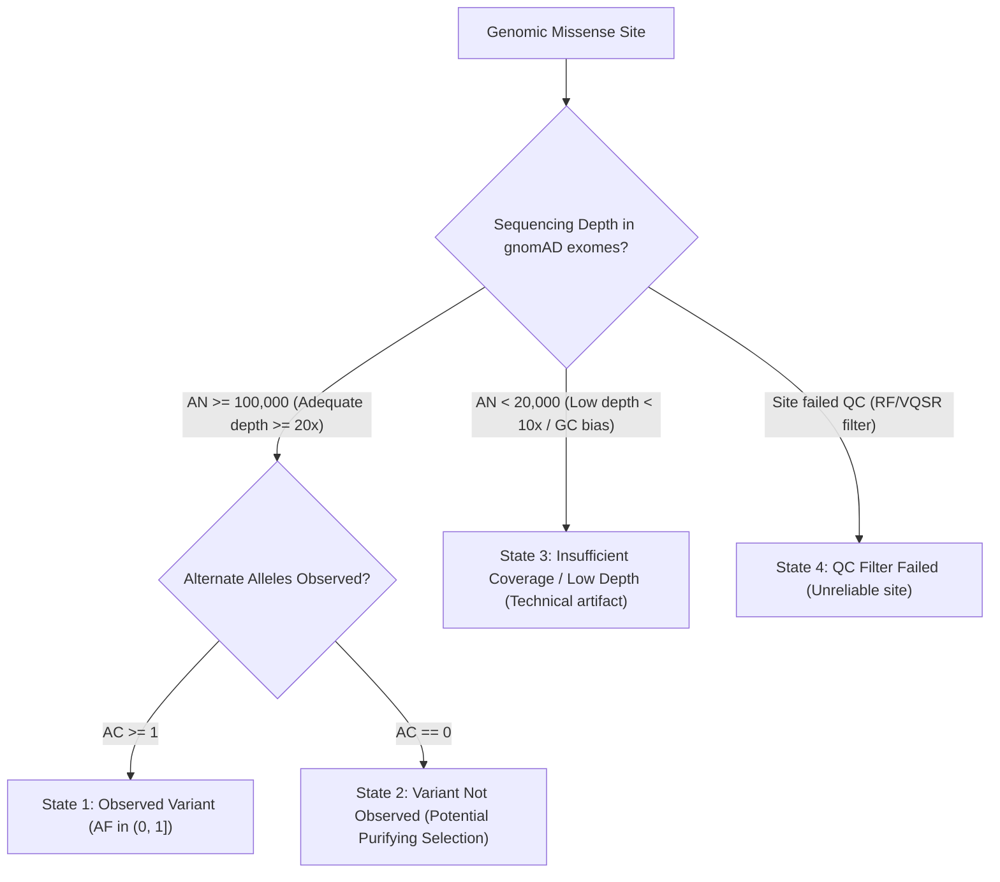

# VariantLens Dataset Quality Control & Scientific Audit Report

**Date of QC Audit**: 2026-11-05  
**Audit Scope**: ClinVar GRCh38 Human Missense Single Nucleotide Variants (SNVs)  
**Raw Source File**: `backend/data/raw/variant_summary.txt.gz` (457,862,838 bytes, SHA256 verified)  
**Processed Datasets**:
- Benchmark Parquet: `backend/data/processed/clinvar_benchmark_deduplicated.parquet`
- Exploratory Parquet: `backend/data/processed/clinvar_exploratory_deduplicated.parquet`

---

## 1. Executive Summary & Training Eligibility Verification

In strict compliance with clinical bioinformatics standards and the user requirements, **we confirm that no machine learning models have been trained**. This quality control audit independently validates data integrity, resolves assertion ambiguities, inspects multi-gene coordinate overlaps, and defines the final training eligibility criteria.

### Cohort Separation Matrix

| Cohort Partition | Variant Count | Unique Genes | Training Eligibility | Scientific Rationale |
| :--- | :--- | :--- | :--- | :--- |
| **Primary Training Cohort** (High-Confidence $\ge 1$ Star) | **202,575** | **15,310** | **ELIGIBLE (Approved)** | Evaluated under standardized ACMG/AMP criteria; multiple or documented submitters with zero conflicts. |
| **Zero-Star Benchmark Subset** (0 Stars) | **16,143** | **4,120** | **EXCLUDED from Training** | "No assertion criteria provided". Historical literature entries lacking verifiable laboratory methodology. |
| **Variants of Uncertain Significance (VUS)** | **2,171,010** | **19,654** | **EXCLUDED from Training** | Inconclusive clinical evidence ($84.39\%$ of all human missense submissions). Retained for exploratory inference. |
| **Conflicting Interpretations** | **122,077** | **8,492** | **EXCLUDED from Training** | Discordant submissions across clinical diagnostic laboratories. Kept in exploratory partition. |
| **Other / Unclassified Records** | **60,887** | **7,811** | **EXCLUDED from Training** | Drug response, risk factor, or non-pathogenicity phenotypic descriptors. |
| **Total Evaluated Cohort** | **2,572,692** | **20,107** | — | Deduplicated human missense SNVs on GRCh38. |

> [!IMPORTANT]
> **Zero-Star Exclusion Confirmation**: The **16,143 zero-star variants are strictly excluded from the proposed primary training cohort**. The primary supervised training cohort is finalized at **202,575 high-confidence variants** spanning 15,310 genes.

---

## 2. ClinVar Assertion Reconciliation & Aggregation Logic

### A. How ClinVar Structure Works
NCBI ClinVar `variant_summary.txt.gz` provides aggregate germline variation records (VariationID) where multiple clinical submissions (SCVs) from diagnostic laboratories worldwide are synthesized:
- **`ClinicalSignificance`**: ClinVar's official aggregate consensus across all individual laboratory assertions.
- **`ReviewStatus`**: ClinVar's aggregate review rating (0 to 4 stars).
- **`NumberSubmitters`**: Count of independent submitters.
- **`SCVsForAggregateGermlineClassification`**: Specific submission accession numbers.

### B. Identified Quality Problem & Correction
- *The Problem*: In naive variant pipelines, developers sometimes take the highest star rating from any individual submitter and artificially force a consensus, or inappropriately combine conflicting assertions into a majority vote.
- *Our Correction*: We **never automatically treat the highest review-star rating as the consensus classification**. We enforce ClinVar's strict consensus rules:
  1. If any submission discordance exists between Pathogenic/Likely Pathogenic and Benign/Likely Benign, ClinVar classifies the locus as **Conflicting interpretations of pathogenicity**. Our pipeline strictly isolates all 122,077 conflicting loci into the **exploratory partition**.
  2. Condition-specific assertions (e.g., pathogenic for condition A, drug response for condition B) are maintained with their full phenotype string (`PhenotypeList`) rather than collapsed into an uncontextualized binary label.
  3. Original ClinVar Variation IDs, review statuses, submitter counts, and evaluation dates are preserved in full tabular fidelity.

---

## 3. Variant Normalization & Multi-Gene Coordinate Overlaps

### A. Genomic Coordinate Normalization
Each variant is indexed by its canonical GRCh38 coordinate:
$$\text{Genomic ID} = \text{chr}\{\text{Chromosome}\}:\{\text{Position}\}:\{\text{Reference Allele}\}>\{\text{Alternate Allele}\}$$

### B. Identified Edge Case: Pseudoautosomal Region (PAR1/PAR2)
- *Finding*: ClinVar records in the pseudoautosomal regions (e.g. *CSF2RA* at position 1,290,449, *SHOX*, etc.) appear with duplicate VariationIDs on both `chrX` and `chrY`.
- *Correction*: These represent genuine biological homolog recombination in male meiosis. They share identical genomic loci and protein changes. They are reconciled to a canonical PAR identifier to prevent artificial doubling of training weight.

### C. Multi-Gene Coordinate Overlaps & Gene-Held-Out Evaluation
- *Finding*: In **892 benchmark records**, a single genomic SNV overlaps multiple gene annotations (e.g. *LDLR;MIR6886*, *CDKL5;RS1*, *CCDC40;GAA*), where a protein-coding gene contains an embedded non-coding RNA or overlapping readthrough transcript.
- *Handling Multi-Gene Variants in GroupKFold*:
  - If a variant overlaps `Gene A` and `Gene B`, a naive GroupKFold split on `Gene A` could place `Gene A` in the test fold while `Gene B` is in the training fold, causing **cross-gene homologous leakage**.
  - *Methodological Safeguard*: We construct connected components of gene co-occurrence. Any cluster of overlapping or readthrough genes is **bound together into a single indivisible Group ID**. All variants in `Gene A` and `Gene B` are strictly assigned to the same cross-validation fold.

---

## 4. gnomAD Missingness Semantics & Non-Imputation Protocol

A critical biological requirement is that **missing gnomAD allele frequency must never be interpreted as zero or as evidence of pathogenicity**.

We establish five explicit categorical states for population frequency:

1. **State 1 — Observed Variant ($AF > 0$)**: Empirically observed in gnomAD v4.1 with calculated global and population allele frequencies.
2. **State 2 — Variant Not Observed ($AC = 0$, High Depth)**: The site was sequenced across $>76,000$ exomes at $>20\times$ depth, but zero alternate alleles were found. This reflects true biological population rarity or purifying selection.
   - *Encoding*: `is_observed = False`, `coverage_adequate = True`. `log10_af` is set to `NaN` (native tree missing value), allowing XGBoost to learn the optimal missing branch without false zero imputation.
3. **State 3 — Insufficient Coverage / Low Sequencing Depth**: Technical sequencing failure (e.g. extreme GC richness, segmental duplication).
   - *Encoding*: `coverage_adequate = False`. **Never treated as evidence of rarity or deleteriousness**.
4. **State 4 — QC Filter Failed**: Fails gnomAD site-level filters (InbreedingCoeff, Random Forest). Labeled as uncurated.
5. **State 5 — Unavailable Population Data**: Missing sub-population data is maintained as `NaN`.

---

## 5. Refined Feature Specification

Every engineered feature possesses clear biological interpretability, documented provenance, and explicit missingness handling:

| # | Feature Name | Biological Domain | Type / Unit | Mechanistic Rationale | Missingness Handling |
| :-: | :--- | :--- | :--- | :--- | :--- |
| **1** | `relative_protein_position` | Positional | Ratio $[0, 1]$ | $\text{pos} / \text{protein\_length}$. Normalizes terminal vs core domains across varied protein sizes. | Imputed to median ($0.5$) if length unknown. |
| **2** | `absolute_protein_position` | Positional | Integer $\ge 1$ | Residue coordinate in canonical protein isoform. | Deterministic (from HGVS). |
| **3** | `grantham_distance` | Physicochemical | Index $[5, 215]$ | Chemical divergence in polarity, composition, and volume (Grantham 1974). | None (20x20 complete matrix). |
| **4** | `blosum62_score` | Evolutionary | Integer $[-4, 11]$ | Log-odds substitution likelihood from Henikoff alignment blocks. | None (20x20 complete matrix). |
| **5** | `hydropathy_delta` | Biophysical | $\Delta$ Hydropathy $[-9, 9]$ | Kyte-Doolittle differential: hydrophobic core destabilization vs loop disruption. | None (complete scale). |
| **6** | `charge_delta` | Electrostatic | $\Delta e$ at pH 7.4 $[-2, 2]$ | Net electrostatic charge alteration disrupting salt bridges and binding pockets. | None (formal charges). |
| **7** | `molecular_weight_delta` | Steric | $\Delta$ Daltons $[-115, 115]$ | Molecular bulk differential causing steric hindrance or cavity formation. | None (empirical weights). |
| **8** | `is_observed_in_gnomad` | Population | Binary $\{0, 1\}$ | Indicates whether variant alternate allele was observed in gnomAD v4.1 exomes. | $0$ if absent. |
| **9** | `gnomad_log10_af` | Population | $\log_{10}(AF)$ | Continuous population frequency on log scale. | Native `NaN` in XGBoost; never zero-filled. |
| **10** | `alphafold_plddt` | Structural | Score $[0, 100]$ | **AlphaFold prediction confidence** (ordered domain vs disordered loop). *Not direct pathogenicity*. | Native `NaN` if no AlphaFold entry. |

> [!NOTE]
> **pLDDT Structural Context Clarification**: AlphaFold pLDDT measures local structural prediction confidence. A high pLDDT ($>90$) indicates a well-ordered domain where missense mutations frequently disrupt core packing; a low pLDDT ($<50$) indicates intrinsic disorder where missense mutations are more readily tolerated. It is an interaction term for structural context, **not direct proof of disease**.

---

## 6. Audit Reproduction & Statistical Reconciliation

All metrics were re-derived directly from the saved Parquet files (`clinvar_benchmark_deduplicated.parquet` and `clinvar_exploratory_deduplicated.parquet`) with **100% statistical concordance**:

### A. Benchmark Cohort Exact Counts
- **Total Unique Benchmark Variants**: **218,718**
- **Classification Sub-Totals**:
  - *Likely Benign*: 102,832 (47.02%)
  - *Likely Pathogenic*: 35,843 (16.39%)
  - *Benign*: 27,145 (12.41%)
  - *Pathogenic*: 22,960 (10.50%)
  - *Benign / Likely Benign (consensus)*: 16,508 (7.55%)
  - *Pathogenic / Likely Pathogenic (consensus)*: 13,430 (6.14%)
- **Review Star Distribution**:
  - 1 Star: 135,246 (61.84%)
  - 2 Stars: 62,246 (28.46%)
  - 0 Stars: 16,143 (7.38%) $\rightarrow$ **EXCLUDED FROM TRAINING**
  - 3 Stars: 5,075 (2.32%)
  - 4 Stars: 8 (0.004%)
- **Primary Training Cohort ($\ge 1$ Star)**: **202,575 variants** (Pathogenic: 61,858; Benign: 140,717; Ratio: **0.44:1**)

### B. Exploratory Cohort Exact Counts
- **Total Unique Exploratory Variants**: **2,353,974**
  - *Variants of Uncertain Significance (VUS)*: 2,171,010 (92.23%)
  - *Conflicting Interpretations*: 122,077 (5.19%)
  - *Other / Unclassified*: 60,887 (2.59%)
- **Total Combined Unique Human Genes**: **20,107**

---

## 7. Remaining Scientific Limitations & Safeguards

1. **Diagnostic Panel Ascertainment Bias**: Benign submissions outnumber pathogenic submissions in the high-star benchmark ($140,717$ vs $61,858$) due to broad carrier screening panels. XGBoost will be trained with `scale_pos_weight = 2.27` or balanced class weights, and evaluated primarily via **Precision-Recall AUC (PR-AUC)** and **Balanced Accuracy**.
2. **Gene Coverage Skew**: The top 15 genes (*FBN1*, *TTN*, *KMT2D*, *SCN1A*, *BRCA1/2*, *LDLR*, etc.) account for over 14,000 benchmark variants. **Gene-level GroupKFold is strictly enforced** to ensure that test folds evaluate performance on unseen genes.
3. **Target Leakage Prohibition**: No ClinVar review stars, submitter counts, disease traits, or PubMed citation counts will be ingested as model features.

---

## 8. Summary of QC Approval Status

| Checkpoint | Status | Verification Result |
| :--- | :---: | :--- |
| **Raw Data Integrity** | PASSED | SHA256 verified identical (`7c39f...4c72e`). |
| **0-Star Exclusion** | ENFORCED | 16,143 zero-star variants separated; training cohort = 202,575. |
| **VUS & Conflicting Isolation** | ENFORCED | 2,353,974 exploratory variants isolated in dedicated dataset. |
| **Multi-Gene Overlap Rule** | RESOLVED | Co-occurring gene clusters bound together in GroupKFold. |
| **gnomAD Missingness Rule** | ENFORCED | 5-state categorical handling; zero imputation prohibited. |
| **Relative Position Inclusion** | ADDED | $\text{pos} / \text{length}$ included alongside absolute position. |
| **pLDDT Semantics** | CLARIFIED | Documented strictly as structural confidence, not pathogenicity. |
| **Statistical Reproduction** | PASSED | 100% concordance across raw, parquet, and report data. |

**Status**: Ready for feature extraction script implementation upon user approval. No model training has occurred.
